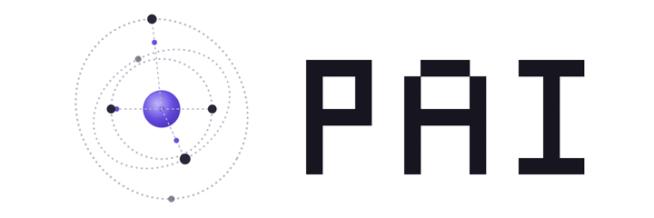

# PAI — your personal AI cloud

<p align="center"></p>

PAI runs your AI agents across every machine you own, on any model, with one memory that is never lost.

- **Any model, any account.** Claude and ChatGPT subscriptions through their official sign-in, or any API key: Anthropic, OpenAI, OpenRouter, DeepSeek, xAI, Ollama and every OpenAI-compatible server. A session can move to another account or vendor at any time, and moves by itself when an account hits its usage limit.
- **Every machine is a node.** Install one binary on a Linux, macOS or Windows machine and your agents can work on it, over an encrypted mesh with no inbound port.
- **Memory that learns.** PAI remembers facts, preferences, decisions, todos and procedures across sessions, models and machines. It keeps only what lasts, merges what repeats, refuses secrets, and never deletes. A learnt policy decides when to recall and how much.
- **Sessions that never fill up.** At 70% of the context, PAI compacts the oldest records into a summary. The full history stays on disk.
- **See everything.** A web app shows a live graph of your machines, models and sessions, every chat, and exactly what PAI knows and why it recalls it. A terminal app does the same in a terminal.

```
 you ── web app / TUI / CLI ──► PAI server ──► Claude · ChatGPT · any API
                                   │   ▲
                 memory, sessions ─┘   └─ tools run on your machines (mesh)
```

## Quick start

On an always-on machine (a VPS, a home server, your desktop):

```bash
curl -fsSL https://github.com/ThongHHuynhh/PAI/releases/latest/download/install.sh | sh -s -- server quickstart
```

The quickstart connects a model provider, then your other machines. Open the web app at the server's URL, under `/app/`, and sign in with the API key the install printed.

Connect another machine with the line the server prints (`pai-server join` prints it again):

```bash
curl -fsSL https://github.com/ThongHHuynhh/PAI/releases/latest/download/install.sh | sh -s -- https://pai.example.com XXXX-XXXX
```

Windows uses `install.ps1` the same way. See [docs/self-hosting.md](docs/self-hosting.md) for URLs, tunnels, accounts and failover, and [docs/architecture.md](docs/architecture.md) for how it works.

## Build from source

Go 1.27 and Node 22:

```bash
cd web && npm ci && npm run build && cd ..
go build -o working_dir/ ./cmd/pai ./cmd/pai-server
```

`go test ./...` runs the tests. The web app's build is committed in `web/dist`, so `go build` alone works too.

## License

Apache License 2.0: see [LICENSE](LICENSE) and [NOTICE](NOTICE). PAI includes code from other projects under their licenses: see [THIRD_PARTY_NOTICES](THIRD_PARTY_NOTICES).
